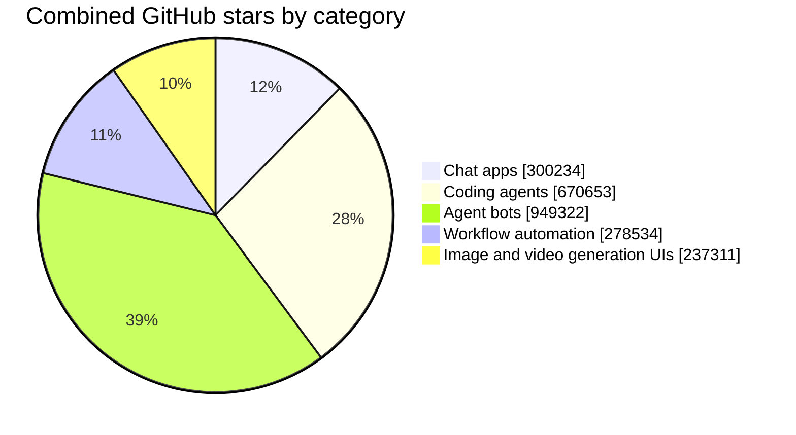

# Awesome Craft Agents 

> A curated list of open-source chat apps, coding agents, self-hosted agent bots, workflow automation and image-generation UIs.

Self-hosted agents can read files, run commands and send messages once you connect tools or chat accounts. Review the project, licence and permission model before adding API keys, wallets or inboxes. This list is not a recommendation to grant those permissions, and it is not investment advice.

These tools can look like commercial chat apps, coding assistants or workflow products, but they are not exact substitutes for Claude Desktop, Claude Code, Grok Bot, n8n Cloud or Midjourney. Licences vary, including fair-code and source-available terms. Connecting an agent to Telegram, Discord, Slack, email or an API wallet gives it a path to your messages and secrets; review the project, its licence and its permission model first. Model licences are separate from tool licences. Inference runtimes such as Ollama, llama.cpp and vLLM are listed in Awesome Craft AI.

## Contents

- [Dashboard](#dashboard)
- [Chat apps](#chat-apps)
- [Coding agents](#coding-agents)
- [Agent bots](#agent-bots)
- [Workflow automation](#workflow-automation)
- [Image and video generation UIs](#image-and-video-generation-uis)
- [Related lists](#related-lists)
- [Star history](#star-history)

## Dashboard

<table>
<tr>
<td align="center"><h2>27</h2>listed projects</td>
<td align="center"><h2>5</h2>categories</td>
<td align="center"><h2>2.44M</h2>combined GitHub stars</td>
<td align="center"><h2>436.3k</h2>combined forks</td>
<td align="center"><h2>24/27</h2>pushed in the last 30 days</td>
<td align="center"><h2>4</h2>languages</td>
</tr>
</table>

**FACT** (snapshot taken 2026-11-15, GitHub API): 27 listed projects, 27 of them on GitHub with public repository statistics. Official documentation and other non-GitHub entries are listed but have no stars, forks or push dates.

**ESTIMATE**: 2.44M combined GitHub stars and 436.3k combined forks, summed from those API counts on the snapshot date. Live star badges next to GitHub entries may differ.

### 🏆 Leaderboard

<table>
<tr><th>Rank</th><th>Project</th><th>Kind</th><th align="right">Stars</th><th></th></tr>
<tr><td align="center">🥇</td><td><b>OpenClaw</b></td><td>Personal agent bot</td><td align="right">394.5k</td><td><code>████████████████████</code></td></tr>
<tr><td align="center">🥈</td><td><b>Hermes Agent</b></td><td>Personal agent bot</td><td align="right">263.5k</td><td><code>█████████████</code></td></tr>
<tr><td align="center">🥉</td><td><b>OpenCode</b></td><td>CLI coding agent</td><td align="right">226.9k</td><td><code>████████████</code></td></tr>
<tr><td align="center">4</td><td><b>n8n</b></td><td>Workflow automation</td><td align="right">210.6k</td><td><code>███████████</code></td></tr>
<tr><td align="center">5</td><td><b>AutoGPT</b></td><td>Agent platform</td><td align="right">188.0k</td><td><code>██████████</code></td></tr>
<tr><td align="center">6</td><td><b>ComfyUI</b></td><td>Image and video UI</td><td align="right">146.9k</td><td><code>███████</code></td></tr>
<tr><td align="center">7</td><td><b>Codex CLI</b></td><td>CLI coding agent</td><td align="right">135.3k</td><td><code>███████</code></td></tr>
<tr><td align="center">8</td><td><b>OpenHands</b></td><td>Software agent</td><td align="right">93.5k</td><td><code>█████</code></td></tr>
<tr><td align="center">9</td><td><b>LobeChat</b></td><td>Self-hosted chat UI</td><td align="right">85.5k</td><td><code>████</code></td></tr>
<tr><td align="center">10</td><td><b>Cline</b></td><td>IDE coding agent</td><td align="right">71.6k</td><td><code>████</code></td></tr>
</table>

### Stars by category

### Licences

    

"Custom" or "None" means GitHub could not match a standard SPDX licence, often because of extra terms or an undeclared licence. Read the project licence before you use it commercially.

## Chat apps

- [AnythingLLM](https://github.com/Mintplex-Labs/anything-llm) - A local-first workspace that combines chat with document retrieval. A hosted product from the same authors, if offered, has its own terms. 
- [Cherry Studio](https://github.com/CherryHQ/cherry-studio) - A desktop client for chatting with local and hosted models, including multi-provider support. 
- [Jan](https://github.com/janhq/jan) - A local-first desktop application for running and chatting with models offline. 
- [LibreChat](https://github.com/LibreChat-AI/LibreChat) - A self-hosted chat UI that can connect to many providers and to local OpenAI-compatible servers. 
- [LobeChat](https://github.com/lobehub/lobehub) - A self-hosted chat and agent UI with plugin and multi-provider support. 

## Coding agents

- [Aider](https://github.com/Aider-AI/aider) - A command-line coding agent that edits a local Git repository with the help of an LLM. 
- [Cline](https://github.com/cline/cline) - An open-source coding agent that runs in the editor and can edit files, run commands and use tools. Confirm the current licence in the repository. 
- [Codex CLI](https://github.com/openai/codex) - OpenAI Codex CLI, an open-source command-line coding agent. Confirm the current repository licence and any model-service terms before use. 
- [Continue](https://github.com/continuedev/continue) - An open-source IDE extension for inline and chat-based coding assistance with local or hosted models. 
- [Goose](https://github.com/aaif-goose/goose) - An open-source, local-first coding and task agent originally from Block. The current official repository is aaif-goose/goose (the block/goose path redirects there). 
- [Open Space](https://github.com/Fantomiald/open-space) - A pixel-art desktop office for running several Claude Code sessions at once, with permission prompts, scheduled runs and side-by-side threads. Uses your locally installed Claude Code. 
- [OpenCode](https://github.com/anomalyco/opencode) - An open-source terminal coding agent. The current official repository is anomalyco/opencode (the sst/opencode path redirects there). 
- [OpenHands](https://github.com/OpenHands/OpenHands) - An open-source software-development agent that can edit repositories, run commands and work through tasks in a sandboxed environment. 

## Agent bots

- [Agent Zero](https://github.com/agent0ai/agent-zero) - A self-hosted agent framework that can use tools, write code and run tasks on infrastructure you control. The current official repository is agent0ai/agent-zero (previously frdel/agent-zero). GitHub currently reports no SPDX match, but the repository LICENSE file is MIT; confirm the file you ship. 
- [AutoGPT](https://github.com/Significant-Gravitas/AutoGPT) - A well-known agent platform that can be self-hosted. The repository uses mixed licences: classic and most of the tree are MIT, while autogpt_platform/ uses Polyform Shield, which restricts offering it as a competing hosted service. Read the licence map in the repository. 
- [ElizaOS](https://github.com/elizaOS/eliza) - An open-source TypeScript framework and product stack for autonomous agents, including connectors and a runtime. 
- [Hermes Agent](https://github.com/NousResearch/hermes-agent) - The official Hermes Agent from Nous Research, a self-hosted agent with a terminal UI, persistent memory and a messaging gateway for Telegram, Discord, Slack and other channels. It can use many model providers, including local endpoints. Review permissions before connecting chat accounts or API keys. 
- [Khoj](https://github.com/khoj-ai/khoj) - A self-hostable personal AI that can chat with your documents, run automations and connect from a browser or selected messaging channels. Licence is AGPL-3.0, which has network-use source-disclosure obligations. 
- [Letta](https://github.com/letta-ai/letta) - A platform for stateful agents with long-term memory, formerly MemGPT. The project README may point current development at a companion repository such as letta-ai/letta-code; confirm the source tree you deploy. It can connect to channels such as Slack, Telegram and Discord. 
- [OpenClaw](https://github.com/openclaw/openclaw) - A self-hosted personal assistant, formerly known as Moltbot and Clawdbot, that meets you in messaging channels such as Telegram, Discord, Slack and WhatsApp. It is MIT-licensed. Giving an always-on agent access to chats, files or credentials has real security implications; review the project guidance before connecting accounts. 

## Workflow automation

- [Activepieces](https://github.com/activepieces/activepieces) - An open-source workflow automation tool that can replace many Zapier or n8n-style flows on infrastructure you control. 
- [n8n](https://github.com/n8n-io/n8n) - A workflow automation platform. n8n uses a fair-code, source-available licence (Sustainable Use License), not an OSI open-source licence; read it before you host or resell it for clients. 
- [Node-RED](https://github.com/node-red/node-red) - A flow-based, low-code automation runtime, widely used for wiring APIs, devices and services. 
- [Windmill](https://github.com/windmill-labs/windmill) - An open-source developer platform and workflow engine for scripts, flows and internal tools. 

## Image and video generation UIs

- [ComfyUI](https://github.com/Comfy-Org/ComfyUI) - A node-based interface and backend for running diffusion and related image, video or audio workflows on your own GPU. Model checkpoints have their own licences. 
- [Fooocus](https://github.com/lllyasviel/Fooocus) - A simplified, local, diffusion-based image-generation UI. Check the repository licence and the licences of any model files you load. 
- [InvokeAI](https://github.com/invoke-ai/InvokeAI) - A self-hosted creative toolkit for running diffusion models, with a professional-oriented UI. Model licences remain separate. 
- [SD.Next](https://github.com/vladmandic/sdnext) - A maintained automatic1111-style web UI for local Stable Diffusion and related models, also known as sdnext. Model licences remain separate. 

## Related lists

Other lists in the Awesome Craft series:

- [Awesome Craft](https://github.com/EdisonTKPcom/Awesome-Craft) - A curated list of open-source, self-hostable alternatives to popular SaaS tools.
- [Awesome Craft AI](https://github.com/EdisonTKPcom/Awesome-Craft-AI) - A curated list of open-source, self-hostable AI runtimes, servers, Hugging Face libraries and related infrastructure.
- [Awesome Craft BSC](https://github.com/EdisonTKPcom/Awesome-Craft-BSC) - A curated list of verified open-source clients, SDKs, dev tools and protocol code for BNB Smart Chain and opBNB.
- [Awesome Craft CUDA](https://github.com/EdisonTKPcom/Awesome-Craft-CUDA) - A curated list of open-source CUDA learning material, kernel libraries, tooling and portability projects.
- [Awesome Craft DeepSeek](https://github.com/EdisonTKPcom/Awesome-Craft-DeepSeek) - A curated list of official DeepSeek repositories and open-source harnesses, serving engines, eval tools and fine-tuning stacks that work with DeepSeek models.
- [Awesome Craft DevOps](https://github.com/EdisonTKPcom/Awesome-Craft-DevOps) - A curated list of open-source, self-hostable alternatives to popular DevOps and hosting SaaS tools.
- [Awesome Craft DNA](https://github.com/EdisonTKPcom/Awesome-Craft-DNA) - A curated list of open-source tools for DNA, genomics and synthetic biology.
- [Awesome Craft Ethereum](https://github.com/EdisonTKPcom/Awesome-Craft-Ethereum) - A curated list of verified open-source Ethereum clients, SDKs, dev frameworks, wallets and security tools.
- [Awesome Craft EV](https://github.com/EdisonTKPcom/Awesome-Craft-EV) - A curated list of open-source software and hardware for electric vehicles and charging.
- [Awesome Craft Hardware](https://github.com/EdisonTKPcom/Awesome-Craft-Hardware) - A curated list of open-source tools for PCB, FPGA, ASIC and chip design.
- [Awesome Craft Hyperliquid](https://github.com/EdisonTKPcom/Awesome-Craft-Hyperliquid) - A curated list of verified open-source SDKs, node tools, analytics and community libraries for the Hyperliquid ecosystem.
- [Awesome Craft Jarvis](https://github.com/EdisonTKPcom/Awesome-Craft-Jarvis) - A curated list of open-source tools to run a personal JARVIS-style AI assistant locally, including dashboards, agent runtimes, voice, MCP connections and memory.
- [Awesome Craft Malaysia](https://github.com/EdisonTKPcom/Awesome-Craft-Malaysia) - A curated list of open-source tools useful to Malaysian SMEs, with verified MyInvois support called out separately.
- [Awesome Craft Mars](https://github.com/EdisonTKPcom/Awesome-Craft-Mars) - A curated list of open-source tools and open data for Mars missions and settlement planning.
- [Awesome Craft Neuro](https://github.com/EdisonTKPcom/Awesome-Craft-Neuro) - A curated list of open-source tools for brain-computer interfaces, electrophysiology and neurotechnology.
- [Awesome Craft Robotics](https://github.com/EdisonTKPcom/Awesome-Craft-Robotics) - A curated list of open-source robotics software and hardware, including Microduck, Unitree SDKs, open humanoids, arms, simulation and middleware.
- [Awesome Craft Solana](https://github.com/EdisonTKPcom/Awesome-Craft-Solana) - A curated list of verified open-source Solana clients, SDKs, frameworks, explorers and program libraries.
- [Awesome Craft Space](https://github.com/EdisonTKPcom/Awesome-Craft-Space) - A curated list of open-source tools for spaceflight and rockets, covering orbit simulation, telemetry, launch data and more.
- [Awesome Craft Starlink](https://github.com/EdisonTKPcom/Awesome-Craft-Starlink) - A curated list of open-source tools for Starlink and other LEO satellite internet systems.
- [Awesome Craft Web3](https://github.com/EdisonTKPcom/Awesome-Craft-Web3) - A curated list of open-source DEX protocol code, self-custody software, indexers, frameworks and Blockchain infrastructure.

## Star history

## Contributing

Contributions welcome! Read the [contribution guidelines](contributing.md) first.

If this list is useful, give it a ⭐ so others can find it.

